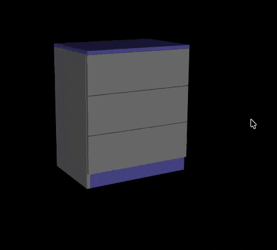

# Parametric Model to MJCF Converter

[](https://opensource.org/licenses/MIT)
[](https://www.python.org/downloads/)

A Python tool to convert parametric model definitions (JSON format) into MuJoCo MJCF (XML) simulation files. This project parses component hierarchies, converts meshes, and builds the kinematic tree for physics simulation.


## Demo

<p align="center">
  
  <br>
  <em>Generated interactive physics model in MuJoCo</em>
</p>

## Features

- **JSON Parsing**: Extracts model instances and kinematic relations from Editor3D JSON
- **Topology Building**: Automatically constructs the kinematic tree (parent, child, joints) from flat auxiliary data
- **Mesh Processing**: Converts mesh data to Wavefront OBJ format and registers them in the MJCF
- **MJCF Generation**: Generates a valid MuJoCo model and saves it as an XML file

## Installation

Install with Conda using the pinned environment in `environment.yml`
(validated on macOS Apple Silicon). `pyproject.toml` defines the Python package
and CLI entry point.

```bash
# Clone the repository
git clone https://github.com/55kwukai/parammodel2mjcf.git
cd parammodel2mjcf

# Create the pinned environment
conda env create -n param2mjcf -f environment.yml
conda activate param2mjcf

# Install the project using the environment's dependencies
python -m pip install --no-deps --no-build-isolation -e .
```

## Usage

### Command Line Interface

After installation, the `param2mjcf` command will be available:

```bash
# Basic usage
param2mjcf input.json

# Specify output file and asset directory
param2mjcf input.json --output my_robot.xml --assets ./my_assets

# Custom model name
param2mjcf input.json --model-name my_robot

# Detailed output (shows topology tree)
param2mjcf input.json -v
```

### Python API

You can also use the package in your own scripts:

```python
from param2mjcf import parse_model_instances, normalize_auxiliaries, build_topology, MujocoBuilderWithMesh

# 1. Load Data
instances = parse_model_instances("input.json")
auxiliaries = normalize_auxiliaries("input.json")

# 2. Build Tree
forest = build_topology(auxiliaries)

# 3. Generate
builder = MujocoBuilderWithMesh(model_name="my_robot")
builder.build(forest, instances)
builder.save_xml("output.xml")
```

## Project Structure

- `param2mjcf/`: Main package source code.
    - `__init__.py`: Package initialization and exports.
    - `cli.py`: CLI entry point.
    - `loader.py`: JSON parsing logic.
    - `topology.py`: Kinematic tree construction.
    - `generator.py`: MJCF XML generation.
    - `types.py`: Data type definitions.
    - `utils.py`: Math and helper functions.
- `archive/`: Old scripts (for reference).
